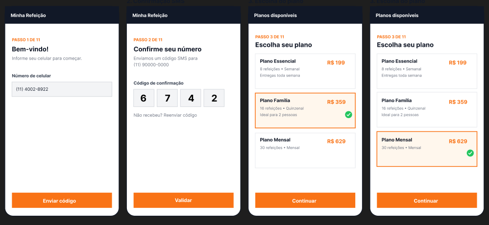
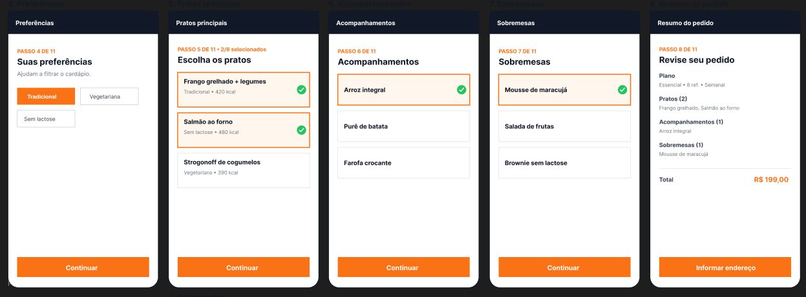
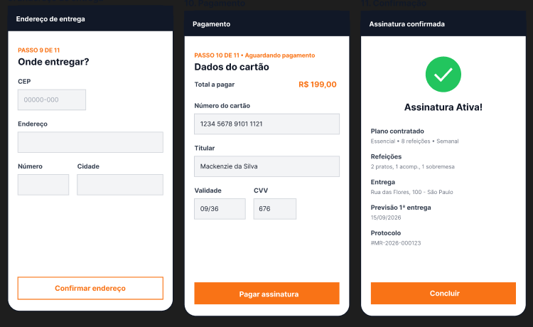
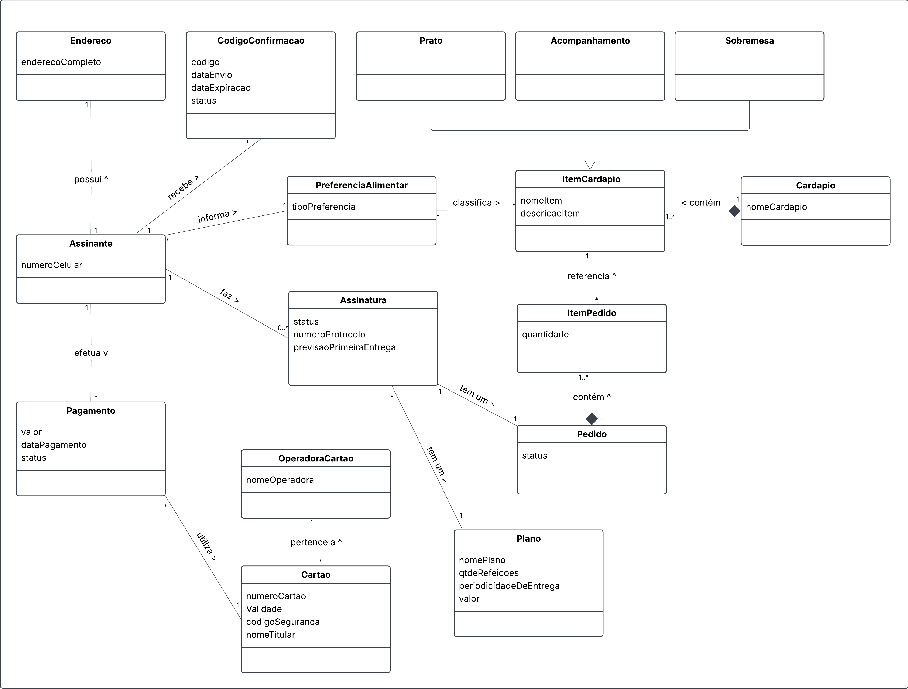
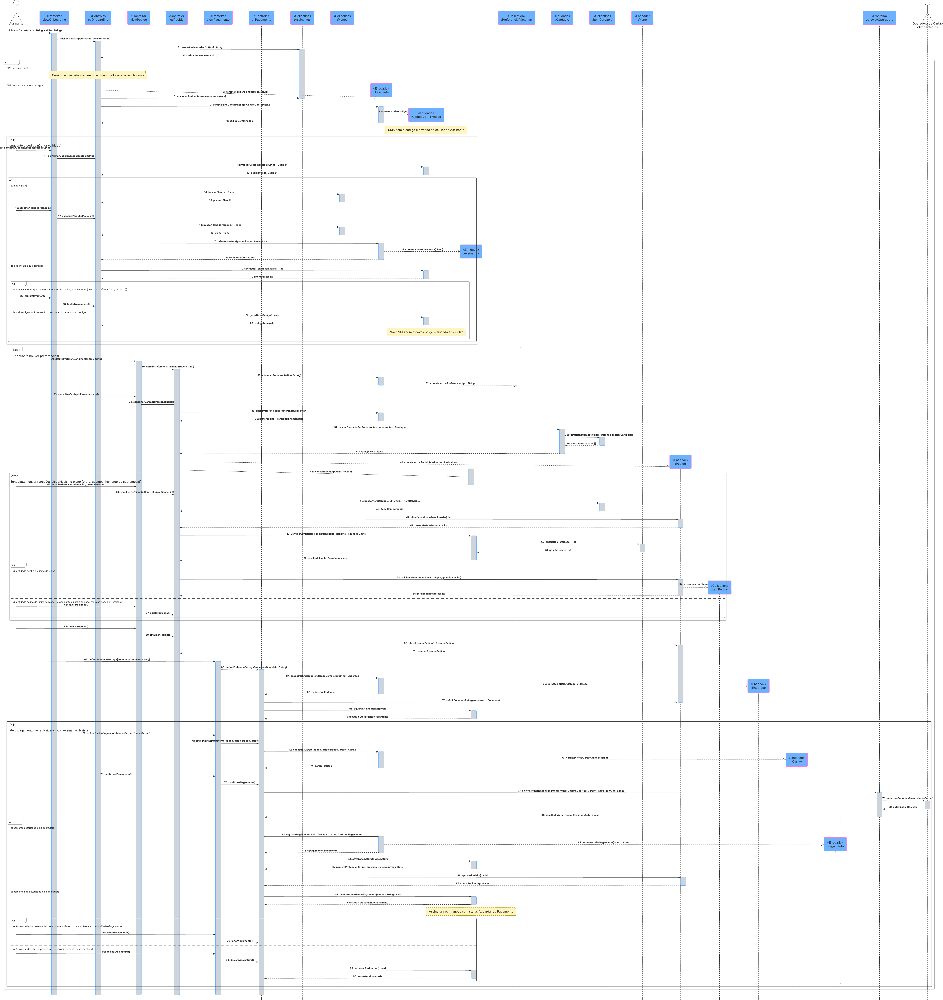
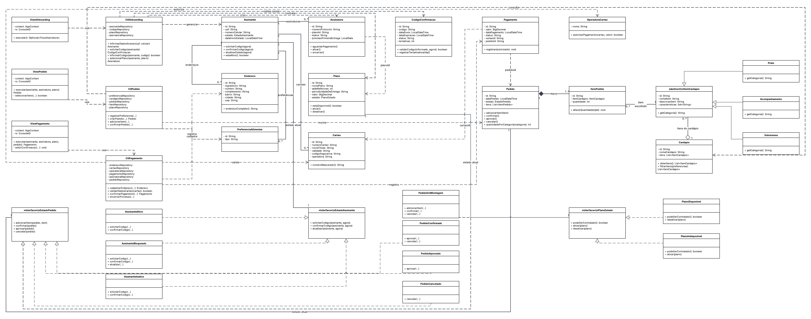

# Serviço de Assinatura de Marmitas (4N)

Este documento apresenta a estruturação das entregas avaliativas do projeto.

---

## GRUPO:

| Nome | RA |
| --- | --- |
| Adam Marinho Falaschi | 10736005 |
| Carlos Fernando Gomes de Pontes | 10444932 |
| Raphael Oliveira Silva Batista | 10732698 |

---

## N1 - Entrega 1:

O bloco N1 - Entrega 1 é composto pelo protótipo com a sequência de telas do projeto e o vídeo explicativo:

### 1. Protótipo do projeto
* **Link do protótipo no Figma:** [Protótipo](https://www.figma.com/design/yqduOJjYlgCcJaGfc2iHdD/Sem-t%C3%ADtulo?node-id=1-274&t=mOEBDBmTkbCYHwkR-1)

### 2. Sequência de telas (caminho feliz)
* Onboarding: etapa em que o usuário inicia o processo de assinatura, informa o número de celular, recebe o código de confirmação via SMS e escolhe seu plano.

<br>



* Escolha de preferências e montagem do pedido: etapa em que o usuário escolhe suas preferências de cardápio, escolhe os pratos, acompanhamentos, sobremesas e revisa seu pedido.

<br>



* Cadastro de endereço e pagamento: etapa em que o usuário cadastra seu endereço, faz o pagamento do pedido com o cartão e revisa sua assinatura.

<br>



### 3. Vídeo de apresentação
* **Vídeo da N1 - Entrega 1:** [Assistir ao Vídeo Explicativo](https://youtu.be/fnZCeVywArA)

---

## N1 - Entrega 2:

O bloco N1 - Entrega 2 é composto pelo Diagrama de Classes de Domínio:

### Diagrama de Classes de Domínio


---

## N2 - Entrega 3:

O bloco N2 - Entrega 3 é composto pelo Diagrama de Sequência e Diagrama de Classes de Projeto

### Notas

Checklist: [visualizar checklist](checklist-entrega-3.pdf)

### Diagrama de Sequência:



### Diagrama de Classes de Projeto:



---

## N2 - Entrega 4:

O bloco N2 - Entrega 4 é composto pela implementação do cenário do caso de uso e vídeo de apresentação.

### Vídeo de apresentação
* **Vídeo da N2 - Entrega 4:** [Assistir ao Vídeo Explicativo](https://youtu.be/VFYdRepPX0A)

Executável: [baixar AssinaturaRefeicoes.jar](AssinaturaRefeicoes.jar)

### Execução

Requer Java 17 ou superior:

```bash
java -jar AssinaturaRefeicoes.jar
```

**Execução pelos fontes (sem JAR):**

Com Java 17 ou superior instalado, abra o terminal na pasta raiz do projeto e compile os arquivos Java:

**Linux/macOS:**

```bash
mkdir -p build
find src/main/java -name "*.java" -print0 | xargs -0 javac --release 17 -encoding UTF-8 -d build
java -cp build br.com.refeicoes.Main
```

**Windows (PowerShell):**

```powershell
New-Item -ItemType Directory -Force build
$sources = Get-ChildItem -Recurse src/main/java -Filter *.java | ForEach-Object { $_.FullName }
javac --release 17 -encoding UTF-8 -d build $sources
java -cp build br.com.refeicoes.Main
```

A pasta `dados/` é criada automaticamente no diretório de execução. Os registros permanecem entre execuções quando a aplicação utiliza a mesma pasta.

### 1. Regras importantes

- **Cadastro:** valida CPF e celular. A confirmação é feita por código SMS simulado de quatro dígitos, com três tentativas por código e possibilidade de reenvio.
- **Preferências:** Tradicional é exclusiva; Vegetariana e Sem lactose podem ser combinadas.
- **Pedido:** o limite do plano é aplicado separadamente a pratos, acompanhamentos e sobremesas.
- **Pagamento:** somente o valor do plano é cobrado. Os componentes do pedido não possuem preços individuais.
- **Endereço:** são permitidas até cinco tentativas de cadastro quando os dados obrigatórios ou o CEP são inválidos.
- **Persistência:** dados do assinante e da contratação são armazenados em arquivos CSV.

### 2. Estrutura

### Estrutura de pastas

```text
ProjetoAssinaturaRefeicoesJava/
├── AssinaturaRefeicoes.jar
├── src/
│   └── main/
│       └── java/
│           └── br/com/refeicoes/
│               ├── Main.java
│               ├── app/
│               ├── control/
│               ├── domain/
│               │   └── state/
│               ├── repository/
│               ├── util/
│               └── view/
└── dados/
    └── Arquivos CSV de persistência
```

### 3. Menu principal

| Opção | Operação |
|---:|---|
| `1` | Contratar assinatura e fazer o primeiro pedido |
| `2` | Fazer novo pedido para um assinante com assinatura ativa |
| `3` | Consultar cadastro e assinatura |
| `4` | Consultar o cardápio geral |
| `5` | Retomar contratação ou pagamento pendente |
| `0` | Encerrar a aplicação |

- O menu reaparece após cada operação.

- A opção `5` exige uma assinatura `PENDENTE` ou `AGUARDANDO_PAGAMENTO` com um pedido já confirmado associado. A retomada passa novamente pelas etapas de endereço e pagamento. `Ctrl+C` encerra a execução.

- O fim da entrada também é tratado (`Ctrl+D` em terminais Unix ou `Ctrl+Z` seguido de Enter no Prompt de Comando do Windows).

### 4. Fluxo de contratação

1. **Identificação:** informar CPF e celular.
2. **Confirmação SMS:** informar o código simulado.
3. **Escolha do plano:** selecionar e confirmar um plano disponível.
4. **Preferências alimentares:** selecionar uma ou mais preferências compatíveis.
5. **Pratos principais:** consultar e selecionar pratos.
6. **Acompanhamentos:** consultar e selecionar acompanhamentos.
7. **Sobremesas:** consultar e selecionar sobremesas.
8. **Resumo do pedido:** revisar itens e quantidades e confirmar a composição.
9. **Endereço de entrega:** informar os dados do endereço.
10. **Pagamento:** escolher a operadora e informar os dados de um cartão fictício.
11. **Confirmação:** visualizar plano, itens, endereço, previsão da primeira entrega e protocolo.

### 5. Planos disponíveis

Os planos são pré-cadastrados em `CatalogoPreCadastrado` e carregados em memória na inicialização.

| Plano | Quantidade de refeições | Periodicidade | Valor |
|---|---:|---|---:|
| Essencial | 8 | Semanal | R$ 199,00 |
| Família | 16 | Quinzenal | R$ 359,00 |
| Mensal | 30 | Mensal | R$ 629,00 |

O valor do plano é o único preço da contratação. Pratos, acompanhamentos e sobremesas estão incluídos.

### 6. Preferências alimentares e cardápio

#### Preferências

- **Tradicional:** deve ser selecionada sozinha; não aplica restrição ao catálogo.
- **Vegetariana:** remove itens marcados com a característica `ANIMAL`.
- **Sem lactose:** remove itens marcados com a característica `LACTOSE`.

Vegetariana e Sem lactose podem ser combinadas; nesse caso, as duas restrições são aplicadas simultaneamente.

#### Itens pré-cadastrados

| Categoria | Opções |
|---|---|
| Pratos principais | Frango grelhado + legumes; Salmão ao forno; Strogonoff de cogumelos |
| Acompanhamentos | Arroz integral; Purê de batata; Farofa crocante |
| Sobremesas | Mousse de maracujá; Salada de frutas; Brownie sem lactose |

O cardápio exibido ao assinante é filtrado pelas preferências registradas. Planos, opções de preferência, itens do cardápio e operadoras são carregados em memória; não são cadastros administrativos persistidos em CSV. As escolhas de preferência do assinante são persistidas.

### 7. Total de refeições e limite por categoria

A quantidade indicada no plano (`qtdeRefeicoes`) representa o número de refeições do plano. Para montar essas refeições, o cardápio possui três categorias de componentes: **um prato principal, um acompanhamento e uma sobremesa**.

O limite `N` é aplicado **separadamente em cada categoria**, e não pela soma das três categorias. Assim, no plano Mensal (`N = 30`), o pedido pode conter até:

| Categoria | Limite individual |
|---|---:|
| Pratos principais | 30 unidades |
| Acompanhamentos | 30 unidades |
| Sobremesas | 30 unidades |

Portanto, podem ser registrados até `3 × N` componentes no pedido. Para compor 30 refeições completas, a seleção esperada é de 30 pratos, 30 acompanhamentos e 30 sobremesas. O limite de cada categoria considera a soma das quantidades de todos os itens daquela categoria. Por exemplo, diferentes pratos compartilham o mesmo limite de 30.

**Comportamento implementado:** o sistema verifica o limite de cada categoria de forma independente. `Pedido.quantidadePorCategoria()` soma os itens dentro da categoria e é usado para aplicar o teto; `Pedido.quantidadeTotal()` apenas verifica se o pedido contém pelo menos um item, não limita a soma das três categorias. O sistema **não exige que as três categorias tenham a mesma quantidade** nem que todas estejam preenchidas. Por isso, uma composição como 30 pratos, 25 acompanhamentos e 30 sobremesas pode ser confirmada. A igualdade das quantidades, necessária para garantir que todas as refeições estejam completas, não é validada nesta versão.

### 8. Validações

#### CPF e celular

- O CPF é validado pelos dígitos verificadores.
- Se o CPF já estiver cadastrado com outro celular, o cadastro é rejeitado; o mesmo CPF com o mesmo celular localiza o assinante existente.
- O celular deve conter DDD e número móvel com 9 dígitos (11 dígitos no total).
- O DDI `55` é aceito opcionalmente e removido antes de persistir o número nacional. Caracteres de formatação são removidos na validação.

#### Código de confirmação

- O código possui quatro dígitos, é gerado localmente e aparece no terminal com a indicação `[SIMULAÇÃO DE SMS]`.
- O código expira após dez minutos.
- São permitidas até três tentativas por código. Após três erros, o código é bloqueado e pode ser solicitado outro; o reenvio gera um novo código e reinicia as tentativas.
- Após 24 horas sem confirmação, o estado do assinante passa de `BLOQUEADO` para `INATIVO` quando o estado é atualizado por uma interação com o sistema. Não há uma tarefa em segundo plano executando essa transição automaticamente.

#### Endereço

O endereço coleta logradouro, número, complemento, bairro, cidade e CEP. Logradouro, número e cidade são obrigatórios; complemento e bairro podem ficar vazios. O CEP deve conter oito dígitos após a remoção de caracteres de formatação. A validação é local e não consulta serviços externos.

A interface permite até cinco tentativas quando os campos obrigatórios ou o CEP são inválidos. Após cinco falhas, o pedido já confirmado pode ser retomado pela opção `5` do menu principal.

#### Cartão e pagamento

Antes de solicitar a autorização, são verificados:

- número do cartão com 13 a 19 dígitos e checksum válido pelo algoritmo de Luhn;
- CVV com 3 ou 4 dígitos;
- validade não vencida (a interface solicita `MM/AAAA`);
- nome do titular não vazio;
- operadora existente no catálogo (Visa, Mastercard ou Elo).

Um cartão inválido não é enviado à operadora simulada. Na simulação, um cartão terminado em `0002` é recusado; os demais cartões que passam pelas validações podem ser aprovados. Em caso de recusa, a interface permite tentar outro cartão ou encerrar o processo.

O arquivo `cartoes.csv` guarda apenas os quatro últimos dígitos, nome do titular, validade e operadora.

### 9. Estados do domínio

O padrão State é utilizado nas entidades `Assinante`, `Plano` e `Pedido`.

#### Assinante

| Estado | Significado |
|---|---|
| `BLOQUEADO` | Cadastro aguardando confirmação do código (estado inicial). |
| `ATIVO` | Código confirmado; o assinante pode contratar e fazer pedidos. |
| `INATIVO` | Prazo de confirmação expirou; pode solicitar novo código. |

`ATIVO` indica que o cadastro/celular foi confirmado. Não significa, por si só, que uma assinatura foi paga.

#### Plano

| Estado | Comportamento |
|---|---|
| `DISPONIVEL` | Pode ser exibido e contratado. |
| `INDISPONIVEL` | Não pode ser contratado. |

#### Pedido

| Estado | Comportamento |
|---|---|
| `EM_MONTAGEM` | Aceita inclusão de itens e pode ser confirmado ou cancelado. |
| `CONFIRMADO` | Não aceita edição (aguarda autorização do pagamento). |
| `APROVADO` | Pagamento autorizado. Não pode ser editado, pago novamente ou cancelado. |
| `CANCELADO` | Estado final. Não pode ser editado, confirmado ou aprovado. |

#### Assinatura

A assinatura inicia em `PENDENTE`. Após o cadastro do endereço, passa para `AGUARDANDO_PAGAMENTO`. Com pagamento aprovado, passa para `ATIVA`. Se uma contratação nova for encerrada após uma recusa, pode passar para `ENCERRADA`. Em um novo pedido de uma assinatura já ativa, uma recusa mantém a assinatura `ATIVA`.

### 10. Resultado do pagamento

- **Aprovado:** o pagamento é registrado pelo valor do plano, o pedido passa para `APROVADO` e a assinatura passa para `ATIVA`. A CLI apresenta o protocolo e a previsão da primeira entrega.
- **Recusado em uma contratação nova:** a assinatura permanece em `AGUARDANDO_PAGAMENTO` e o pedido em `CONFIRMADO`, permitindo nova tentativa com outro cartão. Se o usuário desistir, o pedido é cancelado e a assinatura é encerrada.
- **Recusado em um novo pedido de assinatura ativa:** a assinatura permanece `ATIVA` e o pedido continua `CONFIRMADO` enquanto houver nova tentativa. Se o usuário desistir, o pedido é cancelado e a assinatura ativa é mantida.
- **Cartão inválido:** a validação falha antes da chamada à operadora simulada; o usuário pode informar outro cartão.

A previsão da primeira entrega é definida para três dias após a seleção do plano. O protocolo é gerado pela entidade `Assinatura`.

### 11. Persistência CSV

Os dados do assinante e da contratação são persistidos em arquivos CSV UTF-8, separados por ponto e vírgula. O utilitário `CsvFile` trata delimitadores escapados, barras invertidas e quebras de linha nos campos.

| Arquivo | Conteúdo |
|---|---|
| `assinantes.csv` | CPF, celular e estado do assinante |
| `codigos_confirmacao.csv` | Código, datas de envio/expiração, estado e tentativas |
| `assinaturas.csv` | Plano, protocolo, estado e previsão de entrega |
| `preferencias_alimentares.csv` | Preferências registradas por assinante |
| `pedidos.csv` | Identificação, data e estado dos pedidos |
| `itens_pedido.csv` | Referência ao item de cardápio e quantidade, sem preço |
| `enderecos.csv` | Dados dos endereços de entrega |
| `cartoes.csv` | Últimos quatro dígitos e dados não sensíveis do cartão |
| `pagamentos.csv` | Valor cobrado, data, estado e referências ao cartão e pedido |

Planos, itens do cardápio e operadoras são pré-cadastrados no código e recriados em memória ao iniciar. Não são persistidos como cadastros administrativos.

### 12. Arquitetura e organização do código

O pacote-base é `br.com.refeicoes`.

| Pacote/classe | Responsabilidade |
|---|---|
| `Main` | Seleciona o diretório de dados e inicia a aplicação. |
| `app` | Inicialização do contexto e catálogo pré-cadastrado. |
| `control` | Coordenação dos fluxos e regras de negócio. |
| `domain` | Entidades e regras do domínio. |
| `domain.state` | Estados concretos do padrão State. |
| `repository` | Persistência CSV e acesso aos catálogos em memória. |
| `util` | Validadores, formatadores e utilitário CSV. |
| `view` | CLI, menus e entrada/saída do terminal. |

Principais componentes de interface e controle: `ConsoleApp`, `ViewOnboarding`, `ViewPedido`, `ViewPagamento`, `CtlOnboarding`, `CtlPedido` e `CtlPagamento`.

---